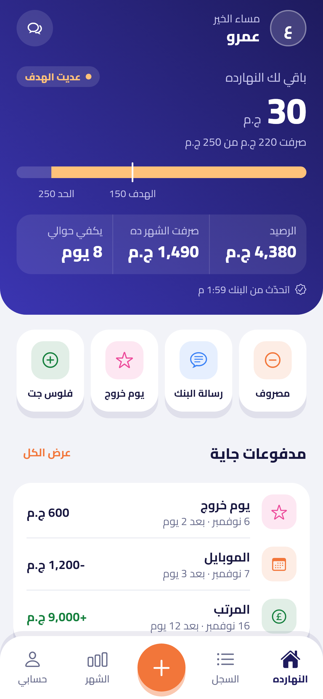
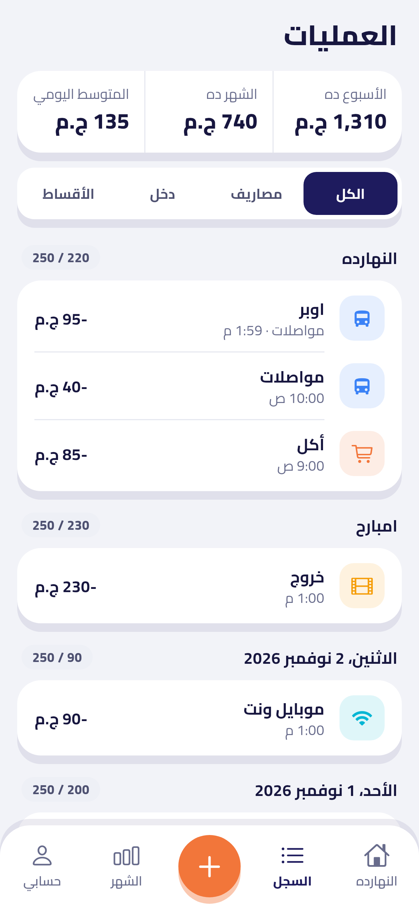
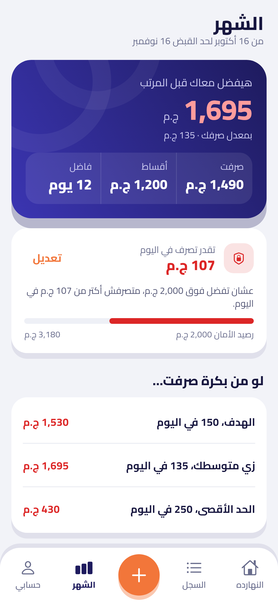
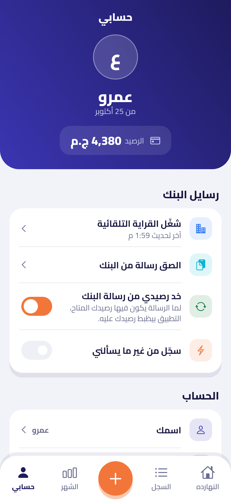
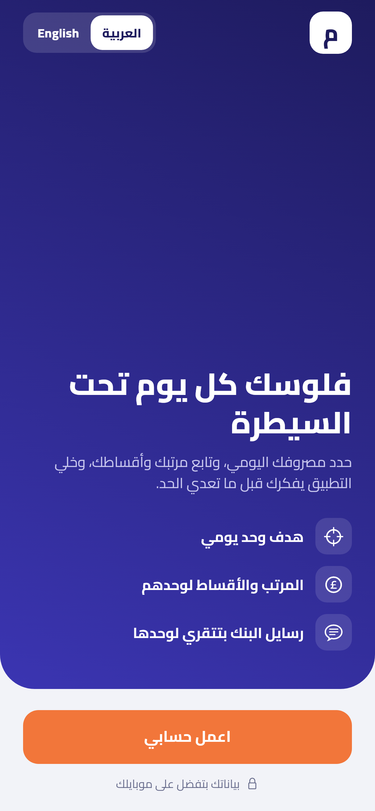
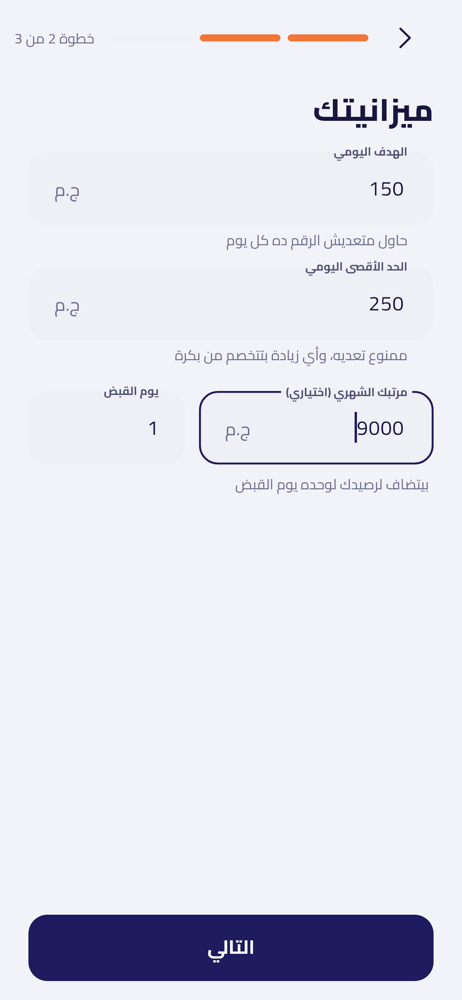
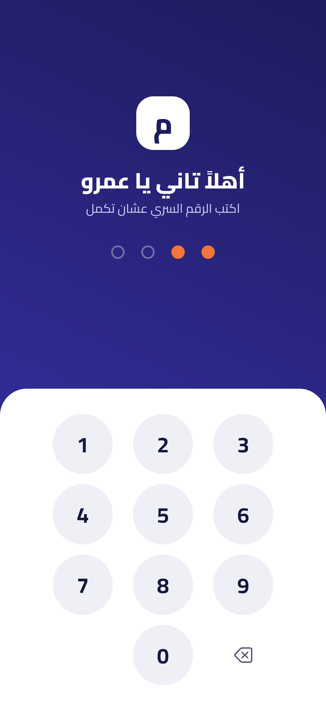
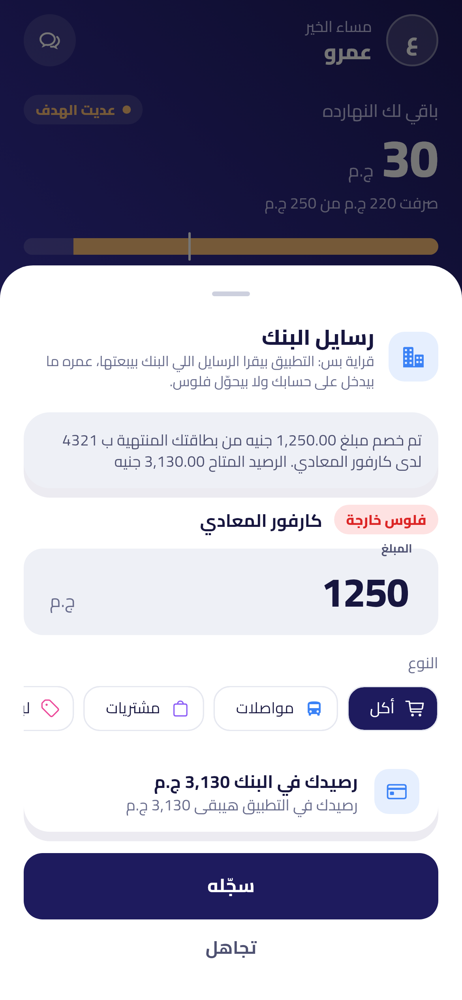
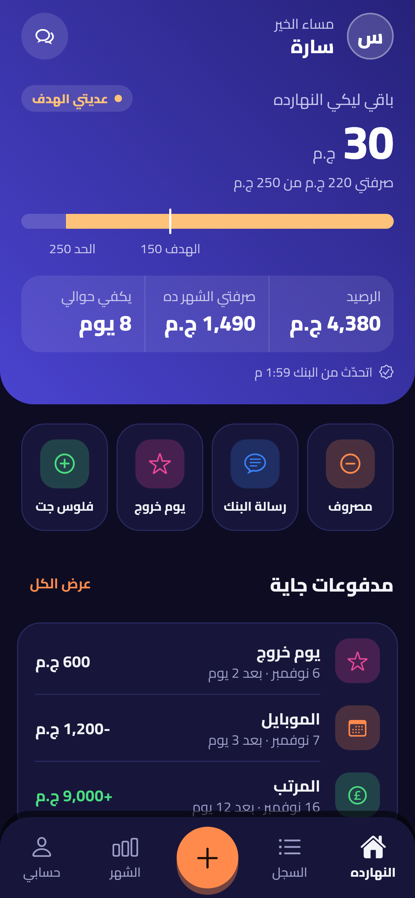

# مصروفي — Masrofy

تطبيق موبايل (Flutter) لمتابعة مصروفك اليومي بحد أدنى وحد أقصى، مع الأقساط وأيام الخروج ومساعد ذكي بيفكرك بكل حاجة.
كل البيانات متخزنة على الموبايل بس — مفيش سيرفر ومفيش ربط بالبنك.

| النهارده | العمليات | الشهر | حسابي |
|---|---|---|---|
|  |  |  |  |

| البداية | إنشاء حساب | الدخول | رسالة البنك | داكن · مؤنث |
|---|---|---|---|---|
|  |  |  |  |  |

## المميزات
- **الرصيد**: بتكتب معاك كام في البنك، وكل مصروف بيتخصم منه. تقدر تعدله أو تضيف فلوس في أي وقت.
- **الحد الأدنى (الهدف) والحد الأقصى** — افتراضياً ١٥٠ و ٢٥٠ ج.م في اليوم:
  - تحت الهدف → أخضر.
  - عديت الهدف → تنبيه أصفر + إشعار.
  - قبل ما تسجل مصروف هيعديك الحد الأقصى → رسالة تحذير تأكيد.
  - لو عديت الحد → الزيادة **بتتخصم من بكرة**. المسموح عمره ما يقل عن الحد الأدنى، والباقي بيتوزع على الأيام اللي بعدها.
  - لو صرفت أقل من الحد الأقصى، الفرق بيسد أي زيادة متخصمة عليك.
- **المرتب**: بتحدد المرتب ويوم القبض، وبيتضاف لرصيدك لوحده كل شهر مع إشعار.
- **تبويب الشهر**: صرفت كام من أول الشهر (أو من آخر قبض)، وهيفضل معاك كام آخر الشهر لو مشيت على الهدف أو متوسطك أو الحد الأقصى، و"رصيد الأمان" اللي مش عايز تنزل تحته مع أقصى صرف يومي يحافظ عليه، وصرفت فين بالنوع.
- **أنواع مصاريف أكتر**: لبس، مكياج وعناية، كوافير وحلاقة، موبايل ونت، البيت، هدايا، أطفال، دراسة… وتقدر تضيف أنواع بنفسك.
- **صيغة الكلام**: بالعربي التطبيق بيكلمك بصيغة المذكر أو المؤنث حسب اختيارك.
- **الأقساط**: الاسم، القيمة، يوم الدفع في الشهر، العدد الكلي والباقي. بتتخصم **تلقائياً** من الرصيد يوم الدفع (منفصلة عن المصروف اليومي)، مع تذكير قبلها بيومين ويوم الدفع.
- **يوم الخروج**: تحدد يوم بميزانية أكبر، والتطبيق يقولك متصرفش أكتر منها، وأي زيادة تتخصم من الأيام اللي بعده.
- **المساعد الذكي**: تنبيهات تلقائية (عديت الحد، قسط قرب، الرصيد مش مكفي الأقساط، بكرة يوم خروج، مسجلتش النهارده، أيام التزام متتالية) وأسئلة سريعة: أقدر أصرف كام النهارده؟ رصيدي هيكفي لإمتى؟ ملخص الأسبوع…
- **إشعارات**: تذكير يومي بمعاد تختاره، تحذيرات الحدود، وتذكير الأقساط وأيام الخروج.
- **إنشاء حساب ودخول**: رقم سري من ٤ أرقام و Face ID.
- **رسايل البنك (قراية بس)**: التطبيق بيقرا رسالة البنك (المبلغ، المكان، رصيدك المتاح) ويسجلها ويظبط رصيدك عليها. على الآيفون اختصار Shortcuts بيبعت الرسالة للتطبيق لوحده، أو تلصقها بنفسك. التطبيق عمره ما بيدخل على حسابك في البنك ولا بيحوّل فلوس.
- **فاتح** (الافتراضي) وداكن وتلقائي، **عربي / English**.

## التشغيل
```bash
flutter pub get
flutter run          # على موبايل أو محاكي Android/iOS
flutter test         # اختبارات قواعد الميزانية والتطبيق
```
لتحديث الصور: `flutter test tool/screenshots_test.dart --update-goldens`

## هيكل المشروع
```
lib/
  main.dart                  نقطة البداية + اختيار الشاشة (إعداد / قفل / التطبيق)
  theme.dart                 الألوان والخطوط (Cairo مدمج في assets/fonts)
  l10n/strings.dart          النصوص بالعربي والإنجليزي
  models/                    المصروف، القسط، الإعدادات
  services/
    month_plan.dart          حساب آخر الشهر ورصيد الأمان
    budget_engine.dart       قواعد الحدود والخصم من اليوم التالي (منطق بحت ومختبر)
    assistant.dart           المساعد الذكي (يعمل على الموبايل بدون إنترنت)
    notification_service.dart الإشعارات
    storage_service.dart     التخزين المحلي
  state/app_state.dart       حالة التطبيق (Provider)
  screens/                   البداية، النهارده، السجل، الشهر (المرتب والأقساط)، المساعد، حسابي، الإعداد، القفل
  widgets/                   تسجيل مصروف، يوم خروج، شريط النهارده، عناصر مشتركة
```

## التنزيل على الآيفون من ويندوز (مجاناً)
1. **بناء ملف IPA** على [codemagic.io](https://codemagic.io): سجل بحساب GitHub ← Add application ← اختار الريبو ← هيقرأ `codemagic.yaml` ← Start new build ← workflow **iOS IPA for Sideloadly** ← لما يخلص نزّل `masrofy.ipa`.
   (بديل: GitHub ← Actions ← **iOS IPA for Sideloadly** ← Run workflow ← نزّل `masrofy-ipa` من Artifacts.)
2. سطّب **iTunes** (من موقع أبل، مش من Microsoft Store) و **[Sideloadly](https://sideloadly.io)**.
3. وصّل الآيفون بالكابل ← Trust. اسحب `masrofy.ipa` على Sideloadly ← اكتب الـ Apple ID ← Start.
4. على الآيفون: Settings ← Privacy & Security ← **Developer Mode** شغّله، وبعدين Settings ← General ← VPN & Device Management ← Trust.
5. بالحساب المجاني التطبيق بيشتغل **٧ أيام** — أعد خطوة ٣ بنفس الـ Apple ID (بياناتك مش بتتمسح).
