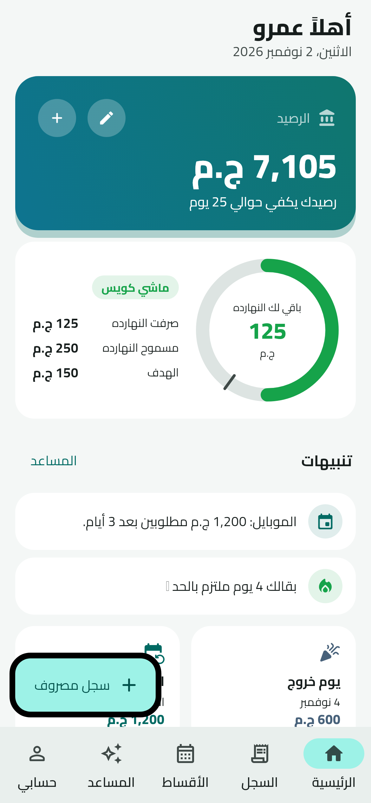
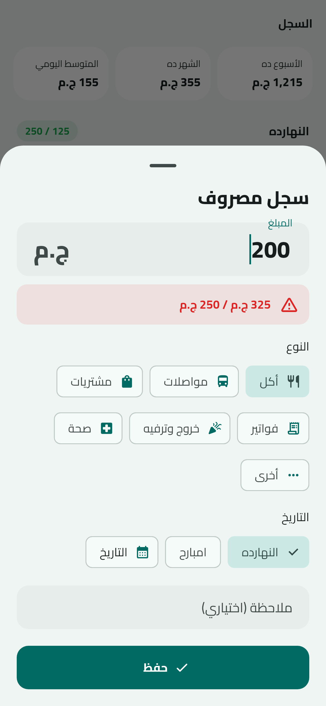
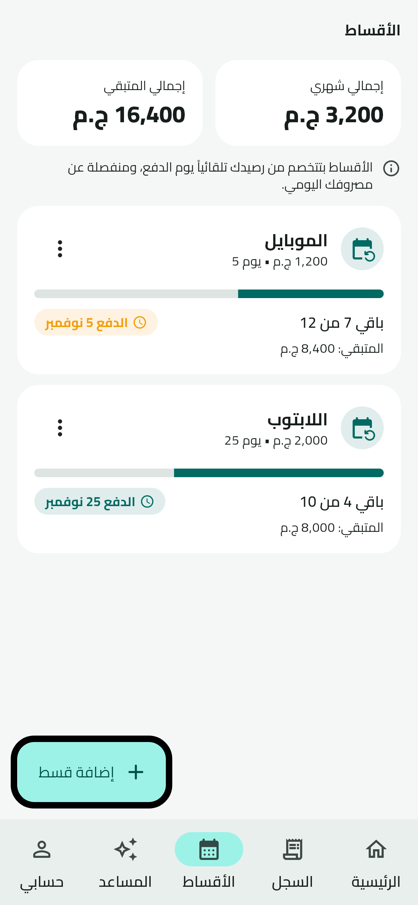
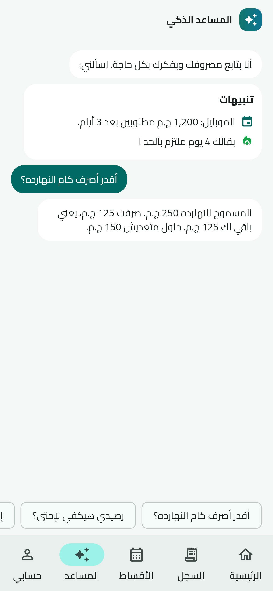

# مصروفي — Masrofy

تطبيق موبايل (Flutter) لمتابعة مصروفك اليومي بحد أدنى وحد أقصى، مع الأقساط وأيام الخروج ومساعد ذكي بيفكرك بكل حاجة.
كل البيانات متخزنة على الموبايل بس — مفيش سيرفر ومفيش ربط بالبنك.

| الرئيسية | تسجيل مصروف | الأقساط | المساعد |
|---|---|---|---|
|  |  |  |  |

## المميزات
- **الرصيد**: بتكتب معاك كام في البنك، وكل مصروف بيتخصم منه. تقدر تعدله أو تضيف فلوس في أي وقت.
- **الحد الأدنى (الهدف) والحد الأقصى** — افتراضياً ١٥٠ و ٢٥٠ ج.م في اليوم:
  - تحت الهدف → أخضر.
  - عديت الهدف → تنبيه أصفر + إشعار.
  - قبل ما تسجل مصروف هيعديك الحد الأقصى → رسالة تحذير تأكيد.
  - لو عديت الحد → الزيادة **بتتخصم من بكرة**. المسموح عمره ما يقل عن الحد الأدنى، والباقي بيتوزع على الأيام اللي بعدها.
  - لو صرفت أقل من الحد الأقصى، الفرق بيسد أي زيادة متخصمة عليك.
- **الأقساط**: الاسم، القيمة، يوم الدفع في الشهر، العدد الكلي والباقي. بتتخصم **تلقائياً** من الرصيد يوم الدفع (منفصلة عن المصروف اليومي)، مع تذكير قبلها بيومين ويوم الدفع.
- **يوم الخروج**: تحدد يوم بميزانية أكبر، والتطبيق يقولك متصرفش أكتر منها، وأي زيادة تتخصم من الأيام اللي بعده.
- **المساعد الذكي**: تنبيهات تلقائية (عديت الحد، قسط قرب، الرصيد مش مكفي الأقساط، بكرة يوم خروج، مسجلتش النهارده، أيام التزام متتالية) وأسئلة سريعة: أقدر أصرف كام النهارده؟ رصيدي هيكفي لإمتى؟ ملخص الأسبوع…
- **إشعارات**: تذكير يومي بمعاد تختاره، تحذيرات الحدود، وتذكير الأقساط وأيام الخروج.
- **عربي / English** مع دعم الاتجاه من اليمين للشمال، وقفل برقم سري اختياري، ووضع ليلي.

## التشغيل
```bash
flutter pub get
flutter run          # على موبايل أو محاكي Android/iOS
flutter test         # اختبارات قواعد الميزانية والتطبيق
```
لتحديث الصور: `flutter test tool/screenshots_test.dart --update-goldens`

## هيكل المشروع
```
lib/
  main.dart                  نقطة البداية + اختيار الشاشة (إعداد / قفل / التطبيق)
  theme.dart                 الألوان والخطوط (Cairo مدمج في assets/fonts)
  l10n/strings.dart          النصوص بالعربي والإنجليزي
  models/                    المصروف، القسط، الإعدادات
  services/
    budget_engine.dart       قواعد الحدود والخصم من اليوم التالي (منطق بحت ومختبر)
    assistant.dart           المساعد الذكي (يعمل على الموبايل بدون إنترنت)
    notification_service.dart الإشعارات
    storage_service.dart     التخزين المحلي
  state/app_state.dart       حالة التطبيق (Provider)
  screens/                   الرئيسية، السجل، الأقساط، المساعد، حسابي، الإعداد، القفل
  widgets/                   تسجيل مصروف، يوم خروج، الحلقة، عناصر مشتركة
```
